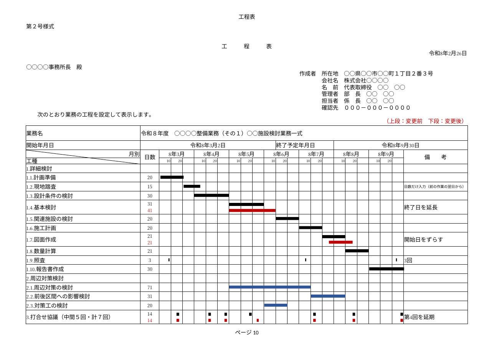

# 工程表 自動作成ツール（Excel マクロ）

Excel に作業項目と開始日・終了日・日数を入れてボタンを押すと、月を上旬・中旬・下旬に区切った工程表を作り、作業ごとの日数と塗りつぶしバーを自動で描きます。



## ファイル

| ファイル | 内容 |
|---|---|
| `工程表自動作成ツール.xlsm` | マクロ入りの本体（サンプルデータ入り） |
| `工程表マクロ.bas` | マクロ単体（Shift-JIS）。マクロが読み込めないときに VBE でインポートする用 |
| `src/GanttMaker.bas` | マクロのソース（UTF-8、GitHub で読む用） |
| `tools/` | `.xlsm` と `.bas` を作り直す Python スクリプト |

## 使い方

1. `工程表自動作成ツール.xlsm` を開き、「コンテンツの有効化」を押す
2. 「入力」シートの黄色いセルに、見出し（業務名・作成者など）と作業項目を入力する
3. ［工程表を作成］ボタンを押す → 「工程表」シートに工程表ができる（何度でも作り直せます）

### 作業項目の入れ方

| 入力 | 自動で決まるもの |
|---|---|
| 開始日＋終了日 | 日数 |
| 開始日＋日数 | 終了日 |
| 終了日＋日数 | 開始日 |
| 日数だけ | 1つ上の作業の翌日から開始 |
| 開始日だけ | 1日だけの作業（照査・打合せなど） |
| 日付なし | 見出し行（バーなし） |

- 作業項目を空欄にして日付を入れた行は、上の作業の追加期間になり、同じ行にバーが増えます（日数は合計）。
- 「バー色」セルを塗りつぶすと、その作業のバーがその色になります（空白なら標準色）。
- 日数は「暦日」と「土日祝除く」を切り替えられます。祝日は「祝日」シートに書きます。

### 日付が変わったとき（変更後のバー）

その作業の行のオレンジの「変更後」欄に新しい日付を入れると、工程表のその行が上下2段になり、**上段に変更前、下段に変更後のバー**が描かれます（日数欄も上が変更前・下が変更後）。

| 変更後に入力 | 意味 |
|---|---|
| 開始日だけ | 日数は同じで日程をずらす |
| 終了日だけ | 開始日はそのままで延長・短縮 |
| 日数だけ | 開始日はそのままで日数を変える |
| 開始日＋終了日（または日数） | そのとおりの期間 |

変更後のバーの色は「変更後バーの色」、変更前のバーの描き方（塗りつぶし／点線／白抜き）は「変更前バーの表示」で選べます。工程表の「終了予定年月日」は変更後の予定で表示されます。

## マクロが動かないとき

- 「このドキュメントのマクロは、マクロセキュリティの設定により無効になっています」と出る場合
  → 「ファイル」→「オプション」→「トラスト センター」→「トラスト センターの設定」→「マクロの設定」で
  「警告を表示してすべてのマクロを無効にする」を選び、開き直して「コンテンツの有効化」を押す。
- ダウンロードしたファイルでブロックされる場合 → ファイルを右クリック →「プロパティ」→「許可する」にチェック。
- マクロが消えてしまった場合 → Alt+F11 →「ファイル」→「ファイルのインポート」で `工程表マクロ.bas` を読み込み、`.xlsm` で保存。

## 作り直し（開発者向け）

```bash
pip install xlsxwriter
python3 tools/build.py
```

`src/GanttMaker.bas` を編集してから実行すると、リポジトリ直下の `.xlsm` と `.bas` が更新されます。
